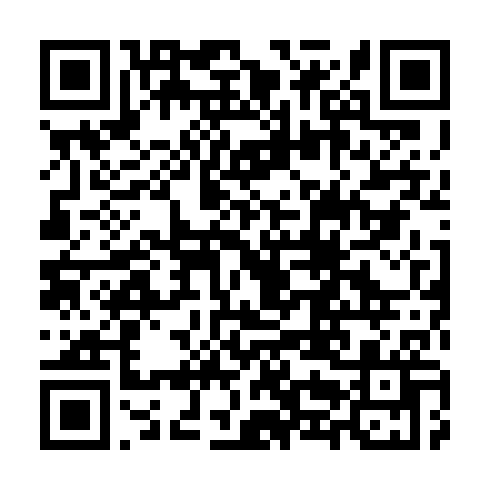
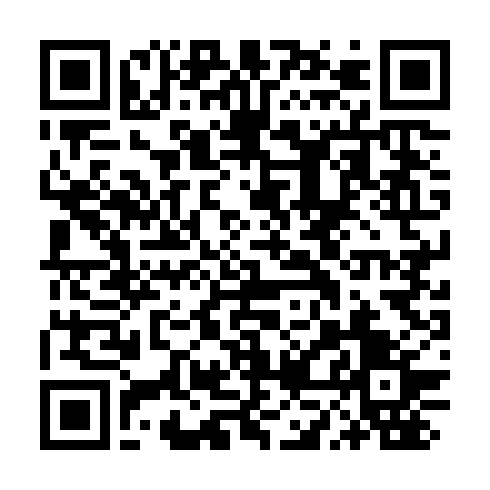
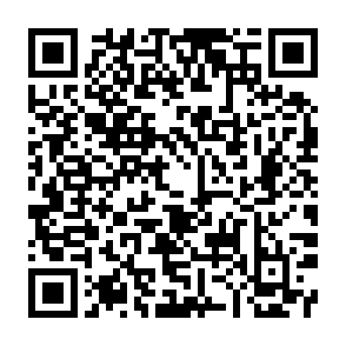

# ARC · CLB AI-Robotics

Ứng dụng nội bộ cho thành viên CLB AI-Robotics. Tài khoản do BCN/Admin cấp.

**[Mở trang tải ứng dụng](https://hyowshi.github.io/ARC-Downloads/)** · [Bản phát hành](https://github.com/HYowshi/ARC-Downloads/releases)

## Nền tảng

**Bản hiện tại: `v1.0.3-test.1`** · [Ghi chú và SHA-256](https://github.com/HYowshi/ARC-Downloads/releases/tag/v1.0.3-test.1)

| Nền tảng | Trạng thái | Tải trực tiếp | QR tải |
| --- | --- | --- | --- |
| Android | APK nội bộ ký bằng khóa ARC ổn định; bản test debug cũ cần gỡ trước khi cài. | [Tải APK](https://github.com/HYowshi/ARC-Downloads/releases/download/v1.0.3-test.1/ARC-Android-test.apk) |  |
| Windows | Bản portable thử nghiệm, chưa ký Authenticode. | [Tải ZIP](https://github.com/HYowshi/ARC-Downloads/releases/download/v1.0.3-test.1/ARC-Windows-test.zip) |  |
| macOS | Universal Intel/Apple Silicon, macOS 12+, chưa notarize. | [Tải ZIP](https://github.com/HYowshi/ARC-Downloads/releases/download/v1.0.3-test.1/ARC-macOS-test.zip) |  |
| iOS | Build native thành công, nhưng chứng chỉ được cung cấp đã bị Apple thu hồi nên chưa ký cài trực tiếp được. Dùng ARC Web/PWA trên Safari. | [Mở ARC Web](https://airoboticsclub.pages.dev/) | — |

QR mở đúng đường dẫn tải. QR không tự cấp quyền cài đặt và không vượt qua cơ chế bảo vệ hệ điều hành.

## Bộ giới thiệu ARC

## Cập nhật trang tải

Trang gồm `index.html`, `styles.css`, `app.js`, `experience.js`; ưu tiên `assets/release.json` đã kiểm tra khi phát hành, cùng phiên bản với manifest QR. Nếu tệp này lỗi, trang mới gọi GitHub API để lấy bản mới nhất. Cách này tránh QR biến mất do API còn cache release cũ.
Khi xuất bản bản mới, chạy `python tool/generate_release_qr.py <tag>` với thư viện trong `tool/requirements.txt`.
Commit ảnh QR, `assets/qr-release.json` và `assets/release.json` cùng nhau. Trang chỉ hiện QR khi tag và đường dẫn khớp release, tránh tải nhầm bản cũ.

Chỉ tải từ repo này; kiểm tra SHA-256 đính kèm mỗi release. Không đưa API key, mật khẩu, hồ sơ riêng hoặc ảnh minh chứng vào repo tải.

## Ảnh và chuyển động

`assets/screenshots` chứa ảnh chụp từ giao diện Flutter ARC đang chạy ở bố cục điện thoại và PC. Ảnh trong thư mục `20261030` dùng dữ liệu minh họa, không chứa hồ sơ thật. Trước khi chụp ảnh mới, không dùng hồ sơ, email, số điện thoại hoặc minh chứng của thành viên.

Hiệu ứng tab trượt, mở ảnh lớn, thẻ xuất hiện và phản hồi nút tham khảo [Lucian Labs](https://lucianlabs.dev/uxui-prompt/), triển khai bằng CSS/JavaScript của trang. Hiệu ứng tôn trọng `prefers-reduced-motion`, không chạy vòng lặp lúc trang đứng yên. Icon nền tảng và giấy phép nằm trong `THIRD_PARTY_NOTICES.md`.

## Trạng thái ký iOS

Workflow ký riêng đã kiểm tra chứng chỉ và provisioning profile. Apple báo chứng chỉ ký đã bị thu hồi, nên quy trình từ chối tạo IPA cài đặt để tránh phát hành tệp không hợp lệ. Build iOS unsigned vẫn được giữ làm đầu vào ký lại khi có identity hợp lệ. Không công khai chứng chỉ, khóa riêng hoặc provisioning profile.

## Điều khoản và quyền riêng tư

ARC dùng hồ sơ CLB, lịch, điểm danh, góp ý và minh chứng đóng quỹ. Camera phục vụ quét QR; vị trí phục vụ điểm danh; ảnh được chọn để gửi minh chứng hoặc quản trị avatar. Quyền từ chối vẫn được hệ điều hành tôn trọng. QR ngân hàng không chứng minh giao dịch hoàn tất; thành viên gửi minh chứng sau khi chuyển khoản.

Dữ liệu do BCN/Admin quản lý. Liên hệ BCN để sửa hồ sơ hoặc đầu mối hỗ trợ bên dưới để yêu cầu xử lý dữ liệu. Chính sách lưu trữ do chủ dự án cung cấp; trang này không tuyên bố ứng dụng đã được cơ quan nào chứng nhận pháp lý.

Trước phát hành chính thức cần CLB phê duyệt chính sách, xác nhận quyền dùng logo và hoàn tất chữ ký phân phối phù hợp với ARC. Quyền dùng chứng chỉ do chủ sở hữu cho phép không thay thế yêu cầu bundle ID, provisioning hoặc APNs của iOS.

## Đầu mối dữ liệu và hỗ trợ

Harashi Yowshi · HarashiYowshi@gmail.com. Theo chính sách chủ dự án cung cấp, dữ liệu được lưu không thời hạn; khi có yêu cầu xóa, đầu mối hỗ trợ tiếp nhận, xác minh người yêu cầu và thực hiện xử lý. Đây hiện là quy trình liên hệ, chưa phải nút xóa dữ liệu tự động trong app. Không gửi mật khẩu/khóa riêng qua email hỗ trợ.

## SEO và chuyển động

Canonical, Open Graph, Twitter Card, SoftwareApplication JSON-LD và sitemap mô tả ARC theo đúng trạng thái phát hành. Không thêm đánh giá, người dùng hoặc lời chứng thực giả. GitHub Pages dạng project không quản lý robots.txt ở gốc hyowshi.github.io; sitemap có thể gửi trực tiếp cho công cụ tìm kiếm nếu cần. SEO không bảo đảm thứ hạng hay thời gian được lập chỉ mục.

Ảnh giao diện mới được chụp từ Flutter ARC đang chạy ngày 30/10/2026, với dữ liệu minh họa. Không có mật khẩu hoặc hồ sơ thật trong các ảnh này. Thanh tiến trình cuộn chỉ đo vị trí đọc trang; không phải tiến trình tải app. Animation sử dụng transform/opacity, IntersectionObserver và requestAnimationFrame theo sự kiện, tôn trọng prefers-reduced-motion; không chạy timer render liên tục.

## ARC 1.0.2 · QR Studio

Ở trang chủ có Tạo mã QR cho mọi thành viên: dán link, chọn mẫu/màu/kiểu, logo, tiêu đề, xuất PNG/SVG, chia sẻ ảnh khi thiết bị hỗ trợ và lưu nháp. Link/logo không gửi lên server. Ảnh được đọc lại để kiểm tra đúng link trước khi cho xuất. QR tĩnh không có thống kê lượt quét hay đổi đích sau khi xuất. Ảnh QR Studio trên trang tải được chụp từ website ARC thật ngày 20/10/2026, link trong ảnh là website công khai của ARC.
