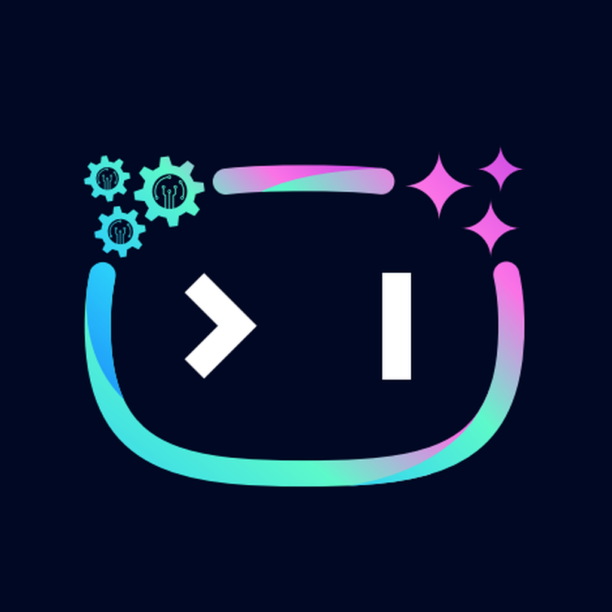

# ARC · CLB AI-Robotics

Ứng dụng nội bộ cho thành viên CLB AI-Robotics. Tài khoản do BCN/Admin cấp.

**[Mở trang tải ứng dụng](https://hyowshi.github.io/ARC-Downloads/)** · [Bản phát hành](https://github.com/HYowshi/ARC-Downloads/releases)

## Nền tảng

| Nền tảng | Trạng thái |
| --- | --- |
| Android | APK thử nghiệm, ký debug; cần người dùng xác nhận cài đặt. |
| Windows | Bản portable thử nghiệm, chưa ký Authenticode. |
| macOS | Bản thử nghiệm chưa notarize; không cam kết Gatekeeper tin cậy. |
| iOS | Build unsigned chưa cài được trực tiếp; chờ chứng chỉ/provisioning hợp lệ cho ARC. |

QR mở đúng đường dẫn tải. QR không tự cấp quyền cài đặt và không vượt qua cơ chế bảo vệ hệ điều hành.

## Cập nhật trang tải

Trang gồm `index.html`, `styles.css`, `app.js`, `experience.js`; tự đọc bản phát hành mới nhất từ GitHub. Nếu GitHub API tạm lỗi hoặc giới hạn lượt gọi, trang dùng `assets/release.json` đã lưu khi phát hành.
Khi xuất bản bản mới, chạy `python tool/generate_release_qr.py <tag>` với thư viện trong `tool/requirements.txt`.
Commit ảnh QR, `assets/qr-release.json` và `assets/release.json` cùng nhau. Trang chỉ hiện QR khi tag và đường dẫn khớp release, tránh tải nhầm bản cũ.

Chỉ tải từ repo này; kiểm tra SHA-256 đính kèm mỗi release. Không đưa API key, mật khẩu, hồ sơ riêng hoặc ảnh minh chứng vào repo tải.

## Ảnh và chuyển động

`assets/screenshots` chứa ảnh chụp trực tiếp client ARC kết nối API, ở bố cục điện thoại và PC. Dữ liệu lịch trống trong ảnh là trạng thái thật tại thời điểm chụp. Khi chụp lại, tránh các trang chứa MSSV, email, số điện thoại hoặc minh chứng.

Hiệu ứng tab trượt, mở ảnh lớn, thẻ xuất hiện và phản hồi nút tham khảo [Lucian Labs](https://lucianlabs.dev/uxui-prompt/), triển khai bằng CSS/JavaScript của trang. Hiệu ứng tôn trọng `prefers-reduced-motion`, không chạy vòng lặp lúc trang đứng yên. Icon nền tảng và giấy phép nằm trong `THIRD_PARTY_NOTICES.md`.

## Điều khoản và quyền riêng tư

ARC dùng hồ sơ CLB, lịch, điểm danh, góp ý và minh chứng đóng quỹ. Camera phục vụ quét QR; vị trí phục vụ điểm danh; ảnh được chọn để gửi minh chứng hoặc quản trị avatar. Quyền từ chối vẫn được hệ điều hành tôn trọng. QR ngân hàng không chứng minh giao dịch hoàn tất; thành viên gửi minh chứng sau khi chuyển khoản.

Dữ liệu do BCN/Admin quản lý. Liên hệ BCN để sửa hồ sơ, hỏi thời gian lưu trữ hoặc yêu cầu xử lý dữ liệu. Không công bố hồ sơ pháp lý được chứng nhận khi chưa có đơn vị chịu trách nhiệm và chính sách lưu trữ được phê duyệt.

Trước phát hành chính thức cần: người/đơn vị chịu trách nhiệm, email hỗ trợ, thời hạn lưu và xóa dữ liệu, cơ sở sử dụng logo, quyền sử dụng chứng chỉ ký, chính sách quyền riêng tư được CLB phê duyệt. Các thông tin này không được tự bịa hoặc thay bằng chứng chỉ của tổ chức khác.

## Đầu mối dữ liệu và hỗ trợ

Harashi Yowshi · HarashiYowshi@gmail.com. Theo chính sách chủ dự án cung cấp, dữ liệu được lưu không thời hạn; khi có yêu cầu xóa, đầu mối hỗ trợ tiếp nhận, xác minh người yêu cầu và thực hiện xử lý. Đây hiện là quy trình liên hệ, chưa phải nút xóa dữ liệu tự động trong app. Không gửi mật khẩu/khóa riêng qua email hỗ trợ.
